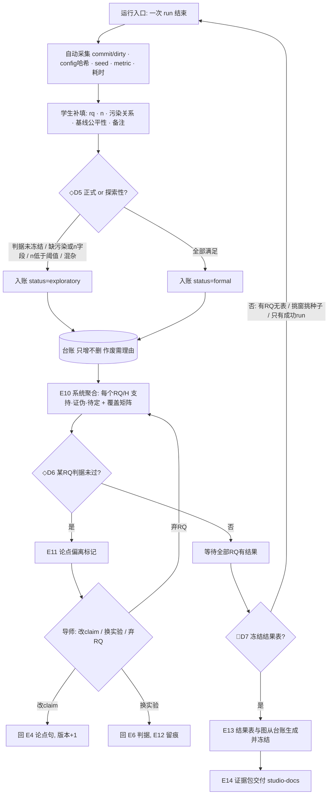

# Process: 实验入账与假设聚合（含回流）

> Domain: academic-paper · Date: 2026-10-23 · 覆盖事件 E9–E13

## 硬规则（来自导师与审稿人）

1. 结果表**只能从台账生成**，不能手填；被排除的 run 必须披露排除理由。
2. 探索性 run **不能事后升级**为正式。
3. 台账行只增不删；作废写理由。
4. 冻结后再改实验视为新一轮（iteration +1，旧结果保留）。

## 瓶颈

- B 步的补填字段若超过 5 个，学生就不填 —— 入账负担是采用率的决定因素（架构师警告）。
- 对接现有日志（wandb / tensorboard / 裸日志）的方式未定（待裁定 #3）。
