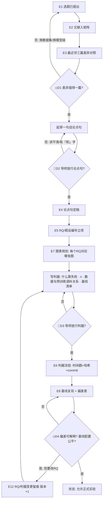

# Process: 开题与判据冻结（定位 → 开题 → 允许正式实验）

> Domain: academic-paper · Date: 2026-10-23 · 覆盖事件 E1–E8

## 泳道

| 泳道 | 职责 |
|---|---|
| 学生 | 矩阵、差异表、论点句草稿、RQ、判据、基线复现 |
| 导师 | D1 / D2 / D3 / D4 判定与签字 |
| 系统 | 矩阵版本、冻结哈希、变更留痕、状态锁（未冻结 → 台账拒收「正式」run） |

## 瓶颈

- D2 常反复 3 次以上（论点句含两个贡献）；
- E8 基线复现耗时最长且最常改变选题，但现在不在任何流程里 —— 这是导师指出的最大缺口。
