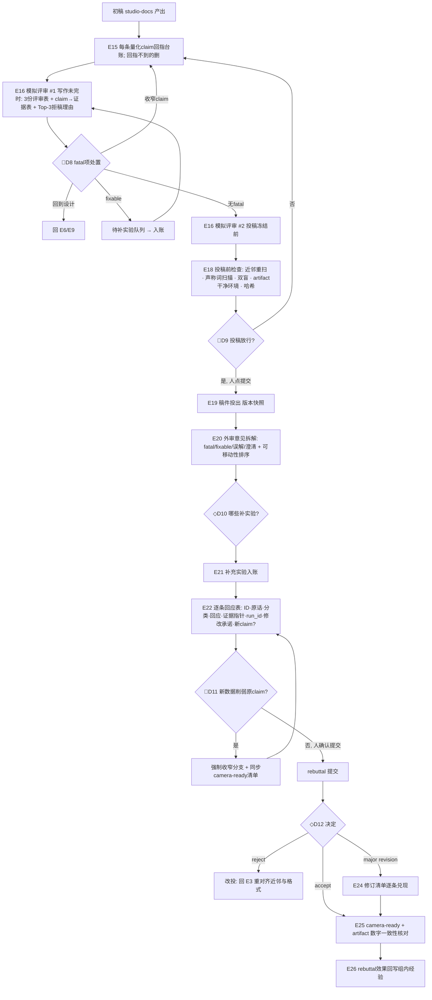

# Process: 内审 → 投稿 → 回应 → 发表

> Domain: academic-paper · Date: 2026-10-23 · 覆盖事件 E15–E26

## 泳道

| 泳道 | 职责 |
|---|---|
| 学生 | claim 回指、意见拆解、补实验、回应表 |
| 运行时审稿人角色 ×3 | 近邻工作作者 / 方法统计 / 相邻领域读者 —— 填目标会议评审表 |
| 导师 | D8 / D9 / D11 签字；提交动作由人点 |
| 系统 | 声称词扫描、回指检查、匿名检查、哈希冻结、字数预算 |

## 硬规则

- 无回应表不得提交 rebuttal；每条回应引用的实验必须已入账。
- 评审表字段每年变，运行时读当年 CFP，不写死。
